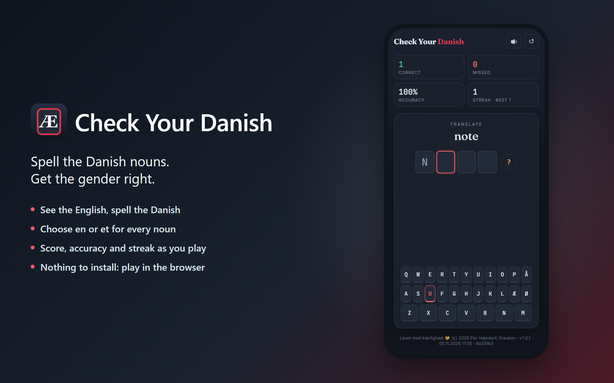

# Check Your Danish

[](https://kreaton.github.io/CheckYourDanish/)
[](LICENSE)


[](https://github.com/kreaton/CheckYourDanish/stargazers)

⭐ If Check Your Danish earns a place on your machine, [star it on GitHub](https://github.com/kreaton/CheckYourDanish) — it's free, made by one developer, and stars are how other people find it.



**A spelling game for English speakers practising Danish nouns.**

**Play it: <https://kreaton.github.io/CheckYourDanish/>**

An English noun is shown with one box per letter of the Danish word, the first letter already
filled in. Type the rest from left to right on the built-in keyboard (or your own), then choose
the gender: **en** or **et**.

- A wrong letter plays a short error sound; keep going until it's right.
- `?` reveals the next letter, which you then still have to type.
- A word spelled and gendered without any mistakes counts as **correct** and plays a success
  sound. A wrong letter, a wrong gender or using `?` counts it as **missed**.
- The score, accuracy and streak are kept in the browser; ↺ resets them.

Keyboard shortcuts: letters (Æ, Ø, Å included), `?` for a hint, `1`/`2` for en/et, and `Enter`
to start or go to the next word.

## The word list

The nouns live in `CheckYourDanish/wwwroot/danish_nouns.json`:

```json
[
  { "danish": "mand", "gender": "en", "english": ["man", "husband"] },
  { "danish": "barn", "gender": "et", "english": ["child"] }
]
```

| Field     | Meaning |
|-----------|---------|
| `danish`  | The Danish word. Letters A–Z, Æ, Ø and Å are typed; É is typed as E, and other characters (like the hyphen in `t-shirt`) are filled in automatically. |
| `gender`  | `en` or `et`. Entries with anything else are skipped. |
| `english` | One or more translations. The first is shown as the prompt, the rest as "also: …". |

Words come in random order, and every word is shown once before any repeats.

## Run

```bash
dotnet run --project CheckYourDanish
```

The app then runs at http://localhost:5147.

## Icons

The app icon (iOS home screen, Windows/Android install via the web app manifest, and the browser
favicon) is drawn by a script into `CheckYourDanish/wwwroot/icons` and `wwwroot/favicon.ico`:

```powershell
powershell -File tools\make-icons.ps1
```

## Version

`Directory.Build.props` sets the version: Major.Minor by hand, and the patch is the GitHub Actions
run number (0 for local builds). The footer shows the version, build time and git commit.

## Deploy

`.github/workflows/deploy.yml` publishes to [GitHub Pages](https://kreaton.github.io/CheckYourDanish/) on every
push to `main` (or manually from the Actions tab).

The page uses a relative `<base href="./">`, so it works in any folder.

## License & Authorship

This project is distributed under the terms of the [MIT License](LICENSE).

**AI authorship note:** Most of the source code in this repository was generated with AI coding agents (Claude Code), under my direction and review. Purely AI-generated material may not be eligible for copyright protection in some jurisdictions. To the extent any part of this project is protected by copyright, it is licensed under the MIT License, and the license's warranty and liability disclaimers apply to the project as a whole.

<!-- notices:start -->
### Independent development

CheckYourDanish is an independent, personal project developed by Per Hejndorf. It is not affiliated with, endorsed by or sponsored by Microsoft or any other rights holder (including Google). Product names and logos are trademarks of their respective owners and are used only to identify the services and tools the project works with.

### Third-party notices and asset provenance

[THIRD-PARTY-NOTICES.md](THIRD-PARTY-NOTICES.md) lists every third-party library, font and online service the project uses, with version, licence, source and whether it was modified. It also records where the icons, images, audio and video came from and how they are licensed.
<!-- notices:end -->
